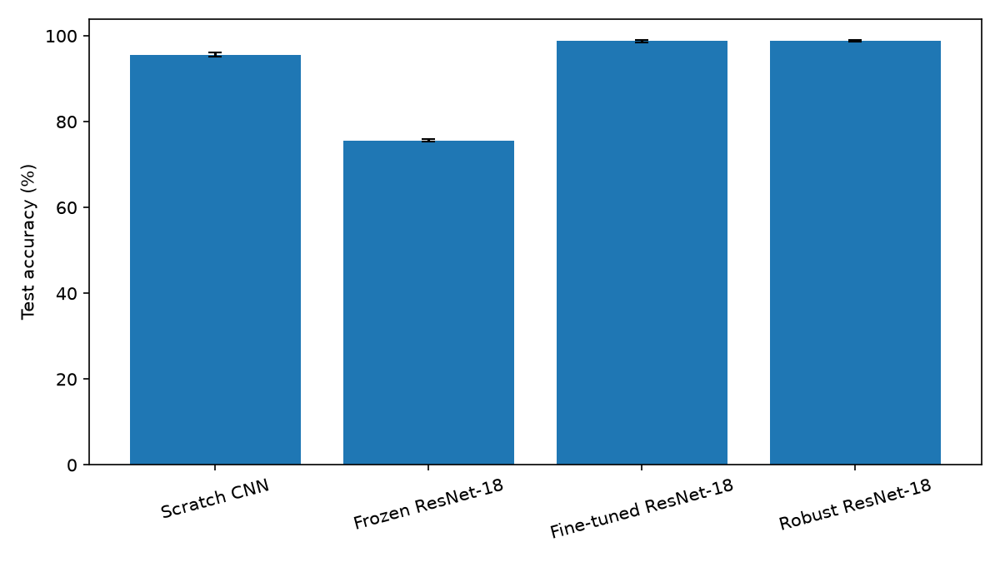
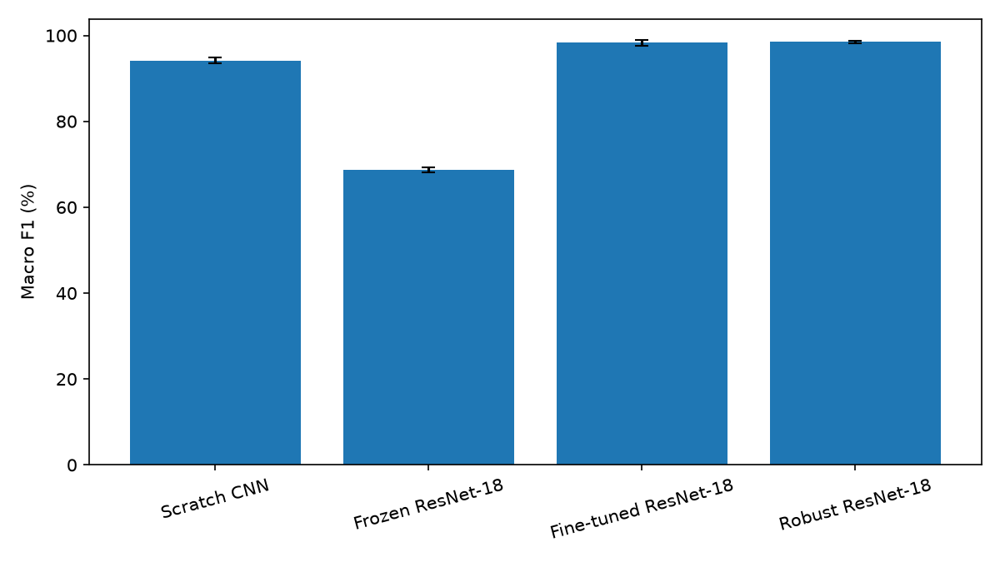
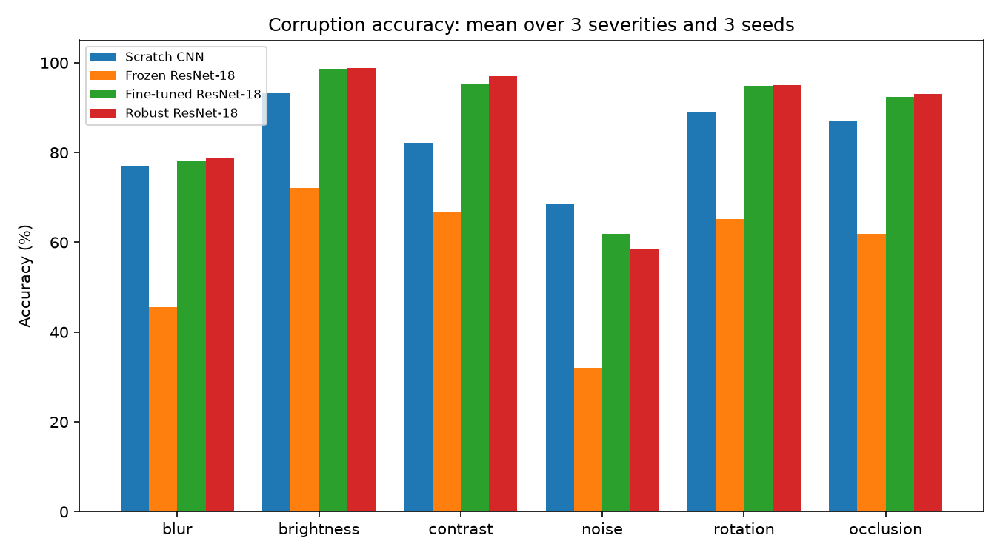
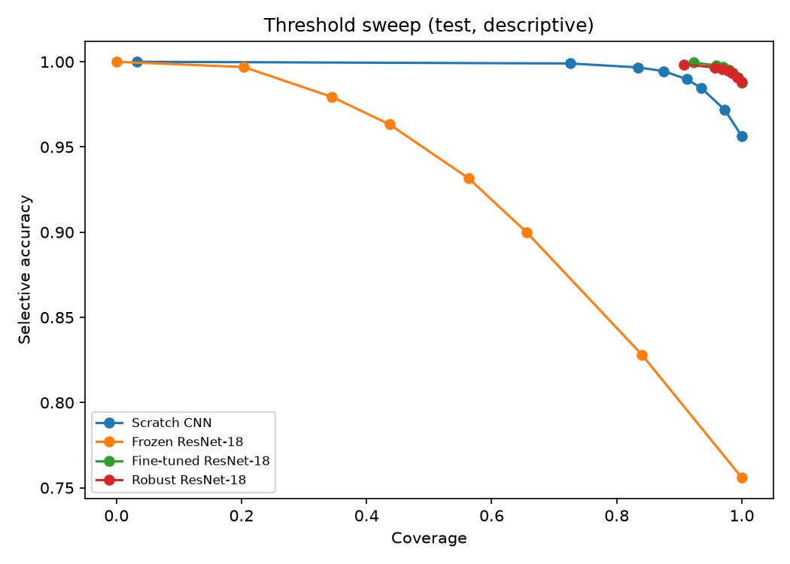
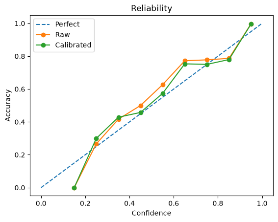

# GTSRB classification: transfer, robustness and uncertainty

## Research question and hypotheses

How do ImageNet transfer, fine-tuning and robustness-oriented augmentation compare
with a scratch CNN for cropped traffic-sign classification? Hypotheses H1–H6
were recorded before these new runs, but after an earlier single-seed CNN test
result had been inspected. This is not a fully preregistered, untouched-test study.

- **H1:** A frozen pretrained backbone improves clean performance over the scratch CNN.
- **H2:** Fine-tuning improves clean performance over a frozen backbone.
- **H3:** Robust augmentation improves corrupted-image performance over ordinary fine-tuning.
- **H4:** Robust augmentation may change clean performance while improving robustness.
- **H5:** Validation-fitted temperature scaling reduces ECE without changing accuracy.
- **H6:** Rejecting low-confidence examples increases accuracy at reduced coverage.

## Dataset and protocol

GTSRB contains 43 classes. We used 31,379 training and 7,830 validation images,
with all frames of each class/physical-sign track assigned to one split, and the
12,630-image official test set. The split's path digest is
`0c9adcd25bcbcfe0729440c6f2ac00947da851a26d3625afeb9949237328e911`;
it identifies the path list, not a hash of image bytes. The test set had already
been examined for an earlier CNN demo, so it was not pristine; no new model,
checkpoint, calibration, threshold, or augmentation choice for this comparison
was made using these test results. A separate external test set is needed for a
fresh confirmation. Data and licensing details are in [DATA.md](../DATA.md).

## Models and setup

The models are the existing 629,291-parameter scratch CNN, ImageNet-pretrained
ResNet-18 with frozen backbone (22,059 trainable of 11,198,571 total parameters),
fully fine-tuned ResNet-18, and fine-tuned ResNet-18 with brightness/contrast
jitter and random Gaussian blur. The ResNets use 224×224 input and ImageNet
normalization; the CNN uses 64×64. All use black square padding and training-time
rotation. These design differences are part of the model comparison, not a
controlled architecture-only ablation.

Each configuration used seeds 2026–2028, batch size 64, AdamW (weight decay
0.0001), cosine scheduling, at most 20 epochs and patience 5. Learning rates
were 0.001 for CNN and frozen ResNet, and 0.0001 for fine-tuned and robust
ResNet. The checkpoint minimizing validation cross-entropy was retained per run.
The runs used Apple MPS on macOS arm64, Python 3.12.0, PyTorch 2.14.1 and
torchvision 0.29.1; recorded training Git revision was `77dc738`. Individual
histories, runtime and dependency metadata are in the locally ignored run folders.
An interrupted fine-tuning run was restarted, not resumed.

## Evaluation and results

Accuracy is micro classification accuracy; macro F1 averages all 43 classes.
ECE uses 15 equal-width confidence bins. Positive scalar temperature and a
confidence threshold targeting 99% validation selective accuracy were fitted
on validation predictions only. Test coverage is the fraction above the fixed
threshold; selective accuracy is accuracy among those accepted. CPU latency is
batch-one median over 50 timed forwards after ten warmups, excluding preprocessing,
on the same reported macOS platform. It is a local benchmark, not a deployment
performance guarantee. Model size below counts parameter bytes only, excluding
buffers and serialization overhead.

Mean ± **sample** standard deviation across three seeds:

| Model | Accuracy | Macro F1 | ECE calibrated | Selective accuracy | Coverage | Parameters | CPU latency |
|---|---:|---:|---:|---:|---:|---:|---:|
| Scratch CNN | 95.63 ± 0.48% | 94.17 ± 0.72% | 0.0066 ± 0.0016 | **99.13 ± 0.23%** | 90.25 ± 1.64% | **0.629M** | **1.06 ± 0.04 ms** |
| Frozen ResNet-18 | 75.59 ± 0.26% | 68.62 ± 0.59% | 0.0212 ± 0.0022 | 97.51 ± 0.29% | 37.01 ± 1.90% | 11.199M | 13.08 ± 1.23 ms |
| Fine-tuned ResNet-18 | 98.75 ± 0.27% | 98.27 ± 0.66% | **0.0026 ± 0.0009** | 98.81 ± 0.18% | **99.91 ± 0.14%** | 11.199M | 11.40 ± 0.48 ms |
| Robust ResNet-18 | **98.80 ± 0.15%** | **98.47 ± 0.30%** | 0.0040 ± 0.0001 | 98.85 ± 0.12% | 99.90 ± 0.08% | 11.199M | 12.60 ± 1.73 ms |

Bold identifies the highest observed mean (lower is better for ECE, size and
latency), not a statistically established winner. Differences of 0.05 percentage
points in clean accuracy should not be overinterpreted with three seeds. CNN
parameters occupy approximately 2.52 MB; ResNet parameters 44.79 MB (decimal
bytes). [Machine-readable results](results/final_summary.json) include individual
seeds and per-run confidence intervals remain in local `test/metrics.json` files.

## Robustness

Six synthetic corruption families, each at three severities, were applied to
all test images using the same corruption seed (2026) and deterministic per-image
seed derivation for every model. The following is accuracy averaged across three
severities and three training seeds; Δ is robust minus ordinary fine-tuning, in
percentage points. The JSON contains each condition, each seed, and changes from
clean accuracy.

| Family | CNN | Frozen | Fine-tuned | Robust | Δ robust − fine-tuned |
|---|---:|---:|---:|---:|---:|
| Blur | 77.07% | 45.51% | 78.11% | 78.67% | +0.56 pp |
| Brightness reduction | 93.25% | 72.03% | 98.63% | 98.79% | +0.16 pp |
| Contrast reduction | 82.18% | 66.92% | 95.27% | 97.03% | +1.76 pp |
| Gaussian noise | 68.48% | 31.99% | 61.92% | 58.51% | −3.41 pp |
| Rotation | 88.94% | 65.24% | 94.86% | 95.08% | +0.22 pp |
| Occlusion | 87.00% | 61.91% | 92.47% | 93.03% | +0.56 pp |

Robust augmentation helped contrast most, especially severity 3 (+4.59 pp),
but reduced noise accuracy at every severity (−1.89, −4.04, −4.31 pp).
The CNN also exceeded both fine-tuned ResNets on mean noise accuracy. These
are synthetic, implementation-specific corruptions, not evidence of real-world
robustness. The augmentation does not explicitly include Gaussian noise.

## Calibration, abstention and uncertainty

| Model | Raw ECE | Calibrated ECE | Raw NLL | Calibrated NLL | Temperature |
|---|---:|---:|---:|---:|---:|
| CNN | 0.0160 ± 0.0018 | 0.0066 ± 0.0016 | 0.1810 ± 0.0250 | 0.1587 ± 0.0207 | 1.565 ± 0.160 |
| Frozen | 0.0356 ± 0.0007 | 0.0212 ± 0.0022 | 0.7904 ± 0.0031 | 0.7818 ± 0.0042 | 1.065 ± 0.013 |
| Fine-tuned | 0.0030 ± 0.0004 | 0.0026 ± 0.0009 | 0.0479 ± 0.0098 | 0.0478 ± 0.0098 | 1.051 ± 0.130 |
| Robust | 0.0056 ± 0.0012 | 0.0040 ± 0.0001 | 0.0522 ± 0.0051 | 0.0517 ± 0.0041 | 1.188 ± 0.033 |

Mean ECE fell in each group, but increased for the fine-tuned 2028 seed; test
NLL increased for fine-tuned 2027 and robust 2028. Temperature scaling preserves
argmax for positive temperatures but does not guarantee lower test ECE or NLL.
The reliability diagram uses 10 bins, while the numeric ECE uses 15.

At the fixed validation-derived operating point, CNN acceptance improved mean
accuracy from 95.63% to 99.13% at 90.25% coverage. Frozen ResNet improved from
75.59% to 97.51% but accepted only 37.01%; it did not reach the 99% validation
target on test. Fine-tuned and robust models accepted nearly all test examples,
with little gain. A target is not a guarantee, and high confidence on unfamiliar
inputs is not evidence of correctness. The curve below is a **descriptive test
sweep**, not a test-tuned deployment threshold; its points average matching
thresholds across seeds. Per-run Wilson intervals use an independent-binomial
approximation and may be too narrow when frames are correlated.

## Errors and explanations

For a representative checkpoint in each model, the seed with the lowest best
validation loss was selected. Error files record paths, ranked top-two logit
margins (a proxy, not calibrated confidence), confusion pairs and low-precision/
recall classes: [CNN](results/error_analysis/cnn_errors.json),
[frozen](results/error_analysis/frozen_resnet18_errors.json),
[fine-tuned](results/error_analysis/finetuned_resnet18_errors.json), and
[robust](results/error_analysis/robust_resnet18_errors.json).

The CNN representative (seed 2027) made 607 errors, including 70 class 7→8
(speed limit 100→120); its double-curve recall was 68.9%. Frozen ResNet seed
2026 made 3,070 errors, including 176 class 1→2 and 143 class 2→1; its go-straight-
or-left recall was 10.0%. Robust seed 2026 made 156 errors, including 31 class
3→5 and 28 class 8→5; bumpy-road recall was 86.7%.

For deeper analysis, we chose the model with lowest **mean validation loss**
(ordinary fine-tuning), then its lowest-validation-loss seed (2028), without
using test performance for the selection. It made 197 test errors. The most
frequent pairs were end-of-80-limit→end-of-no-passing (21), 60→80 km/h (17),
and general caution→double curve (16). Its weakest recall was go straight or
right (85.0%), followed by end-of-80-limit (85.3%); lowest precision was
end-of-no-passing (74.1%). Inspection of paths `03296.ppm`, `08051.ppm` and
`02397.ppm` showed small, dark 60 km/h signs; `03960.ppm`, `07725.ppm` and
`02342.ppm` show small triangular warnings; `02379.ppm` has a highly bright sign,
and `04130.ppm` is very dark. These are recurring observations and confusion
patterns, not proven causes of mistakes.

Grad-CAM overlays were inspected locally for this checkpoint using
`python scripts/study_gradcam_examples.py`: `00002.ppm` and `00026.ppm` show
activation on the sign region, while `00093.ppm` also highlights bright
background around the sign. The incorrect `03296.ppm` highlights the sign
region despite the wrong class. Overlays were generated in padded input
coordinates; the existing demo overlay stretches the heatmap back to the original
image, which can misalign non-square inputs. Grad-CAM is coarse and does not
establish causal reasoning. Images or derived overlays are not committed because
redistribution permission is uncertain; the command generates them locally in
`outputs/study/gradcam_examples/`.

## Ablations and hypotheses

Black versus mean-color padding and ROI cropping were **not run**. In particular,
we cannot conclude that black padding caused a performance difference; the
background activation example is a reason for controlled follow-up, not proof.

- **H1 not supported:** frozen ResNet was below the CNN on clean accuracy.
- **H2 supported:** full fine-tuning strongly exceeded frozen-head training.
- **H3 partially supported:** five corruption-family means improved, while noise worsened.
- **H4 partially supported:** robust clean accuracy was essentially maintained and
  some corruption scores improved; no meaningful clean-accuracy cost is established.
- **H5 partially supported:** mean ECE fell in all groups without changing argmax,
  but one fine-tuned seed's test ECE rose.
- **H6 partially supported:** abstention substantially helped CNN and frozen
  models at a coverage cost; gains were small for the already accurate models.

## Limitations and conclusion

This is classification of pre-cropped signs, not road-scene detection. GTSRB
captures a particular domain; synthetic corruptions do not capture the full
range of weather, camera, geography and out-of-distribution shifts. Three seeds
are insufficient for strong statistical claims, and test frames can be
correlated. ECE depends on binning and evaluation distribution, selective
prediction is not a safety guarantee, and Grad-CAM is not causal evidence.
The previous test exposure, absent padding and ROI ablations, and locally retained
rather than committed checkpoints limit independent verification.

Under this protocol, full fine-tuning was markedly stronger than a frozen
backbone. Robust augmentation improved several corruption categories without a
clear clean-accuracy penalty, but made Gaussian-noise performance worse.
Calibration and abstention helped some operating points while leaving important
uncertainty under distribution shift.
